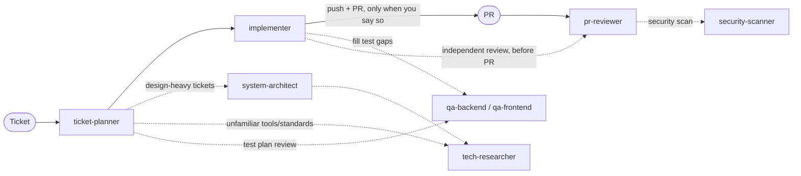

# k-agents

Handy agents for effective, secured, quality full-stack development.



## Agents

### ticket-planner

Plans a ticket (feature or bug) before any code is written. For bugs it first reproduces the issue and traces the root cause, so the plan fixes the cause with a regression test rather than patching the symptom. It checks the ticket is cleared to start (status, blockers, testable acceptance criteria), asks about anything unclear, creates a dedicated worktree, and writes `plans/<ticket>.md`. The plan maps every acceptance criterion to a change, a test, and a Conventional Commit, following the project's conventions. Large tickets are split into phases, each independently mergeable, delivered as one PR per phase or a single PR (your call). It brings in `system-architect` for design-heavy tickets and the QA agents to review the test plan.

**Input:** ticket key, issue number, or URL · **Output:** worktree + plan file

### system-architect

Researches solutions to a design problem, compares 2–4 options (always including "extend what exists") on explicit tradeoffs, and recommends one. Asks for missing requirements and scale numbers instead of guessing, cites sources, and can run throwaway spikes outside the repo.

**Input:** ticket, plan, or design question · **Output:** ADR in the repo's ADR folder

### tech-researcher

Researches tool and library docs, known solutions, and industry standards and conventions for a technical question, matched to the project's actual stack and versions. Every claim is cited, dated, and marked verified or inferred. Reports findings and implications, not the decision.

**Input:** research question, optionally with ticket or plan · **Output:** cited research report in chat

### implementer

Executes a plan in its worktree (one phase per run for phased plans), one planned commit at a time: test first, then code, then format/lint/type check/tests, then a local commit. Guards against regressions by comparing against a pre-change baseline and testing everything that depends on what it touches. Stops to ask when the plan and code disagree. Finishes with QA and an independent `pr-reviewer` pass on its branch, fixing in-scope findings (up to 2 rounds), and only pushes or opens a PR (changelog-style description) when you explicitly say so.

**Input:** ticket key or plan file · **Output:** local commits, PR on request

### qa-backend

Backend unit, API, and e2e tests. API tests use [Hurl](https://hurl.dev) by default. Reviews a plan's test coverage, or writes and runs missing tests for a branch. Never changes production code.

**Input:** plan file, branch, or ticket · **Output:** tests + AC → test → result report

### qa-frontend

Component, browser e2e, accessibility, and visual regression tests, with screenshots saved and checked for browser tests. Reviews a plan's test coverage, or writes and runs missing tests for a branch. Never changes production code.

**Input:** plan file, branch, or ticket · **Output:** tests + screenshots + report

### pr-reviewer

Reviews a GitHub or Bitbucket PR, or a local branch before a PR exists, against its ticket's acceptance criteria, project conventions, YAGNI/DRY, tests, and coverage versus the base branch. Every finding is reproduced or proven before it's reported; unproven ones become questions.

**Input:** PR number/URL, or branch/worktree · **Output:** review in chat, posted only on request

### security-scanner

Snyk/Aikido-style security scan of a PR or branch using open-source scanners (osv-scanner, semgrep, gitleaks, trivy, plus language-native auditors). Reports only what the change introduces, checks the CI's own security pipeline and its results on the PR, and verifies each finding (reachability, exploitability, real vs test secret). Secrets are always masked. Runs standalone or from `pr-reviewer`.

**Input:** PR number/URL, or branch/worktree · **Output:** security report in chat

## Shared principles

- **Never assume.** Unclear details become questions.
- **Project conventions first.** Written rules, then tooling config, then existing patterns.
- **Nothing outward-facing without permission.** No pushing, PRs, ticket changes, or posted comments unless you say so.
- **Docs aren't committed by default.** Plans, ADRs, READMEs, changelogs, and other docs the agents write stay uncommitted until you approve.
- **The repo's commit convention** (Conventional Commits by default), grouped by logic/domain, with **no AI attribution**.

## Handoff log

Each ticket's worktree holds `plans/<ticket>.md` (the spec) and `plans/<ticket>.log.md` (the history). Every agent working on the ticket reads the log at start and appends an entry when it finishes or stops to ask: what it did, your decisions, deviations, open items, links, and the next step. A new session picks up where the last one stopped without re-asking settled questions. Both files are local and untracked, and removing the worktree removes them.

## Install

As a Claude Code plugin:

```
/plugin marketplace add kcayme/k-agents
/plugin install k-agents@k-agents
```

Or, to edit the agents and see changes immediately, symlink them into `~/.claude/agents/` with `./install.sh` (`--uninstall` to remove). Use one method, not both, or every agent shows up twice.

## Use

Each agent has a matching slash command that runs it and relays its questions to you:

```
/k-agents:ticket-planner PROJ-123        # symlink install: /ticket-planner PROJ-123
/k-agents:implementer PROJ-123 phase 2
/k-agents:pr-reviewer #42
/k-agents:security-scanner #42
```

You can also mention an agent (`@agent-k-agents:pr-reviewer review #42`) or ask for it by name. Called these ways, an agent runs as a subagent: it can still delegate to other agents (up to Claude Code's nesting limit, three layers by default), but it can't prompt you directly, so its questions come back through your session.

For the interactive agents, `ticket-planner` and `implementer`, you can instead run the agent as the session itself, so it asks you directly:

```
claude --agent k-agents:ticket-planner   # then: plan PROJ-123
```

With the symlink install, drop the `k-agents:` prefix everywhere.

**Models:** planning, implementing, and reviewing agents (`ticket-planner`, `system-architect`, `implementer`, `pr-reviewer`) and `security-scanner` run on Opus. `qa-backend`, `qa-frontend`, and `tech-researcher` run on Sonnet. Agent files can't declare a fallback model; when running a Sonnet agent directly, add one per session with `--fallback-model opus` (used only if Sonnet is overloaded or unavailable).

## Requirements

- `gh` (authenticated) for GitHub
- Atlassian Rovo MCP for Jira/Confluence
- `bkt` CLI, or `BITBUCKET_EMAIL` + `BITBUCKET_API_TOKEN`, for Bitbucket Cloud
- ponytail plugin (`ponytail-review` skill)
- Hurl, for backend API tests
- `osv-scanner`, `semgrep`, `gitleaks`, `trivy` for `security-scanner` (missing ones are reported as not scanned); `snyk`/`aikido` CLIs optional
