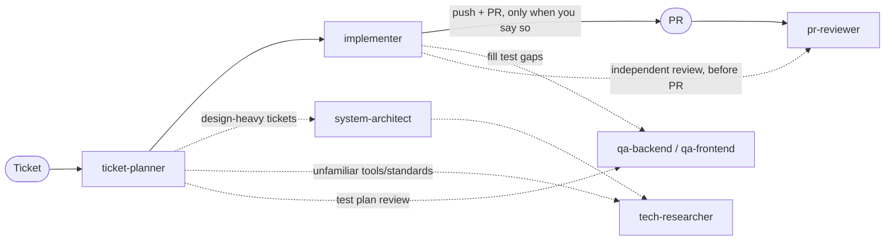

# k-agents

Claude Code agents that take a GitHub/Jira ticket from plan to merged PR.



## Agents

### ticket-planner
Plans a ticket (feature or bug) before any code is written. For bugs it first reproduces the issue and traces the root cause, so the plan fixes the cause with a regression test rather than patching the symptom. It checks the ticket is cleared to start (status, blockers, testable acceptance criteria), asks about anything unclear, creates a dedicated worktree, and writes `plans/<ticket>.md`. The plan maps every acceptance criterion to a change, a test, and a Conventional Commit, following the project's conventions. It brings in `system-architect` for design-heavy tickets and the QA agents to review the test plan.

**Input:** ticket key, issue number, or URL · **Output:** worktree + plan file

### system-architect
Researches solutions to a design problem, compares 2–4 options (always including "extend what exists") on explicit tradeoffs, and recommends one. Asks for missing requirements and scale numbers instead of guessing, cites sources, and can run throwaway spikes outside the repo.

**Input:** ticket, plan, or design question · **Output:** ADR in the repo's ADR folder

### tech-researcher
Researches tool and library docs, known solutions, and industry standards and conventions for a technical question, matched to the project's actual stack and versions. Every claim is cited, dated, and marked verified or inferred. Reports findings and implications, not the decision.

**Input:** research question, optionally with ticket or plan · **Output:** cited research report in chat

### implementer
Executes a plan in its worktree, one planned commit at a time: test first, then code, then format/lint/type check/tests, then a local commit. Guards against regressions by comparing against a pre-change baseline and testing everything that depends on what it touches. Stops to ask when the plan and code disagree. Finishes with QA and an independent `pr-reviewer` pass on its branch, fixing in-scope findings (up to 2 rounds), and only pushes or opens a PR (changelog-style description) when you explicitly say so.

**Input:** ticket key or plan file · **Output:** local commits, PR on request

### qa-backend
Backend unit, API, and e2e tests. API tests use [Hurl](https://hurl.dev) by default. Reviews a plan's test coverage, or writes and runs missing tests for a branch. Never changes production code.

**Input:** plan file, branch, or ticket · **Output:** tests + AC → test → result report

### qa-frontend
Component, browser e2e, accessibility, and visual regression tests, with screenshots saved and checked for browser tests. Reviews a plan's test coverage, or writes and runs missing tests for a branch. Never changes production code.

**Input:** plan file, branch, or ticket · **Output:** tests + screenshots + report

### pr-reviewer
Reviews a GitHub or Bitbucket PR, or a local branch before a PR exists, against its ticket's acceptance criteria, project conventions, YAGNI/DRY, tests, and coverage versus the base branch. Every finding is reproduced or proven before it's reported; unproven ones become questions.

**Input:** PR number/URL, or branch/worktree · **Output:** review in chat, posted only on request

## Shared principles

- **Never assume.** Unclear details become questions.
- **Project conventions first.** Written rules, then tooling config, then existing patterns.
- **Nothing outward-facing without permission.** No pushing, PRs, ticket changes, or posted comments unless you say so.
- **Docs aren't committed by default.** Plans, ADRs, READMEs, changelogs, and other docs the agents write stay uncommitted until you approve.
- **Conventional Commits**, grouped by logic/domain, with **no AI attribution**.

## Install

As a Claude Code plugin:

```
/plugin marketplace add kcayme/k-agents
/plugin install k-agents@k-agents
```

Or, to edit the agents and see changes immediately, symlink them into `~/.claude/agents/` with `./install.sh` (`--uninstall` to remove). Use one method, not both, or every agent shows up twice.

## Use

Run an agent as the main session so it can delegate to the others:

```
claude --agent k-agents:ticket-planner   # then: plan PROJ-123
claude --agent k-agents:implementer      # then: implement PROJ-123
claude --agent k-agents:pr-reviewer      # then: review #42
```

With the symlink install, drop the `k-agents:` prefix.

**Models:** planning, implementing, and reviewing agents (`ticket-planner`, `system-architect`, `implementer`, `pr-reviewer`) run on Opus. `qa-backend`, `qa-frontend`, and `tech-researcher` run on Sonnet. Agent files can't declare a fallback model; when running a Sonnet agent directly, add one per session with `--fallback-model opus` (used only if Sonnet is overloaded or unavailable).

## Requirements

- `gh` (authenticated) for GitHub
- Atlassian Rovo MCP for Jira/Confluence
- `bkt` CLI, or `BITBUCKET_EMAIL` + `BITBUCKET_API_TOKEN`, for Bitbucket Cloud
- ponytail plugin (`ponytail-review` skill)
- Hurl, for backend API tests
