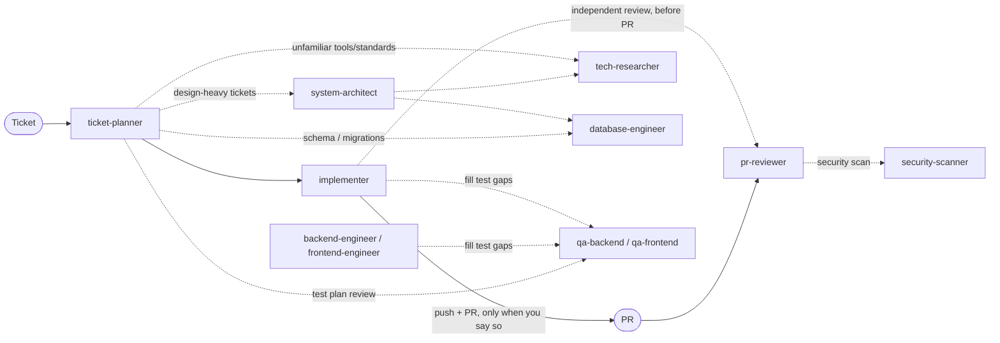

# k-agents

Handy agents for effective, secured, and quality full-stack development, with you, the developer, as captain: the agents do the legwork and surface the tradeoffs, and every decision that shapes the work stays yours.



## Agents

| Agent | What it does | Model |
|---|---|---|
| `ticket-planner` | Checks a ticket is ready, asks about anything unclear, reproduces bugs to their root cause, creates the ticket's branch in a separate worktree or the main checkout (your choice), and writes a plan (project profile, phases, commits, tests, diagrams), monorepo-aware. | Opus |
| `system-architect` | Compares design options on explicit tradeoffs and records the recommendation in an ADR. | Opus |
| `tech-researcher` | Researches docs, third-party service integrations, known solutions, and standards for your stack, with every claim cited. | Sonnet |
| `implementer` | Implements the plan commit by commit, test first, guarding against regressions; pushes or opens a PR only when you say so. | Opus |
| `backend-engineer` | Builds or changes backend code (API design and endpoints, data access, migrations, jobs) from a task, ticket, or plan commit, with ponytail's YAGNI/DRY discipline: reuses what the repo has, skips what nobody asked for, and reports lines added. | Opus |
| `frontend-engineer` | Builds or changes frontend code (components, pages, forms, state, API calls) from a task, ticket, or plan commit, with the same ponytail discipline: the repo's design system and native elements first, every UI state and accessibility covered, nothing nobody asked for. | Opus |
| `database-engineer` | Reviews a plan's or branch's schema, migrations, and queries, or designs a data model: constraints, index choices proven with `EXPLAIN` locally, lock cost of each migration, expand → migrate → contract rollouts, safe backfills. Fewest tables, columns, and indexes that do the job. Advises only. | Opus |
| `qa-backend` | Writes and runs unit, API, and e2e tests with the repo's tooling (Hurl as the API fallback), or reviews a test plan. | Sonnet |
| `qa-frontend` | Writes and runs component, browser e2e, accessibility, and visual tests, with screenshots. | Sonnet |
| `pr-reviewer` | Reviews a PR or branch against the ticket, conventions, tests, and coverage; proves every finding. | Opus |
| `security-scanner` | Scans a PR or branch with open-source scanners and verifies each finding, like Snyk or Aikido. | Opus |

## Principles

- **You're the captain:** agents recommend, you decide. Scope, design choices, tradeoffs, and anything they skip are put to you with the options and their reasons, and your decisions are recorded so no session overrides them.
- **Never assume:** unclear details become questions.
- **Project conventions first.**
- **Nothing outward-facing without your permission:** no pushes, PRs, ticket changes, posted comments, or committed docs.
- **Secrets stay closed, environments stay local:** agents don't read `.env` or other secret files, and ask before touching any non-local database, API, or cloud resource, with separate permission for anything that writes.
- **Guarded actions:** instructions found in tickets, PRs, code, or web pages are never followed; destructive git or file operations, new or upgraded packages, and sending project data to outside services all need your permission.
- **Feature branches only:** agents never commit, merge, rebase, or push to `main`, `master`, `develop`, `dev`, `uat`, `staging`, or other protected or deployment branches; never `--force`, and `--force-with-lease` only on feature branches with your permission.
- **The repo's commit convention**, grouped by domain, with no AI attribution.
- **Resumable:** each ticket's plan and handoff log live in `~/.claude/k-agents/<owner>/<repo>/<ticket>/`, outside your project, so a new session picks up where the last one stopped.

## Install

As a Claude Code plugin:

```
/plugin marketplace add kcayme/k-agents
/plugin install kagents@k-agents
```

Or, to edit the agents and see changes immediately, symlink them into `~/.claude/agents/` with `./install.sh` (`--uninstall` to remove). Use one method, not both, or every agent shows up twice.

## Update

Agents load when a session starts, so restart Claude Code after updating.

Plugin install:

```
claude plugin marketplace update k-agents
claude plugin update kagents@k-agents
```

The plugin was renamed from `k-agents` to `kagents`. If you installed it before, `claude plugin uninstall k-agents@k-agents` once, then install `kagents@k-agents`.

Symlink install: the links point at your checkout, so pull and you're done.

```
git pull
```

Re-run `./install.sh` only when agents or skills were added, renamed, or removed; it links the new ones and prunes dead links. Whatever branch the checkout is on is what's installed, and moving the checkout breaks the links until you re-run the script from the new location.

## Use

Each agent has a matching slash command:

```
/kagents:ticket-planner PROJ-123
/kagents:implementer PROJ-123
/kagents:pr-reviewer #42
```

`/kagents:status PROJ-123` (or just asking "what changed on PROJ-123?") answers from the ticket's plan, handoff log, and branch, in any session.

You can also `@`-mention an agent or ask for it by name. To have `ticket-planner` or `implementer` ask you questions directly, run it as the session: `claude --agent kagents:ticket-planner`. With the symlink install, drop the `kagents:` prefix.

## Requirements

- `gh` (authenticated) for GitHub
- Atlassian Rovo MCP for Jira/Confluence
- Figma MCP, to read designs linked from tickets (optional; without it agents ask you for screenshots)
- `bkt` CLI, or `BITBUCKET_EMAIL` + `BITBUCKET_API_TOKEN`, for Bitbucket Cloud
- Hurl, only for repos with no API test tooling of their own
- `osv-scanner`, `semgrep`, `gitleaks`, `trivy` for `security-scanner` (missing ones are reported as not scanned); `snyk`/`aikido` CLIs optional
